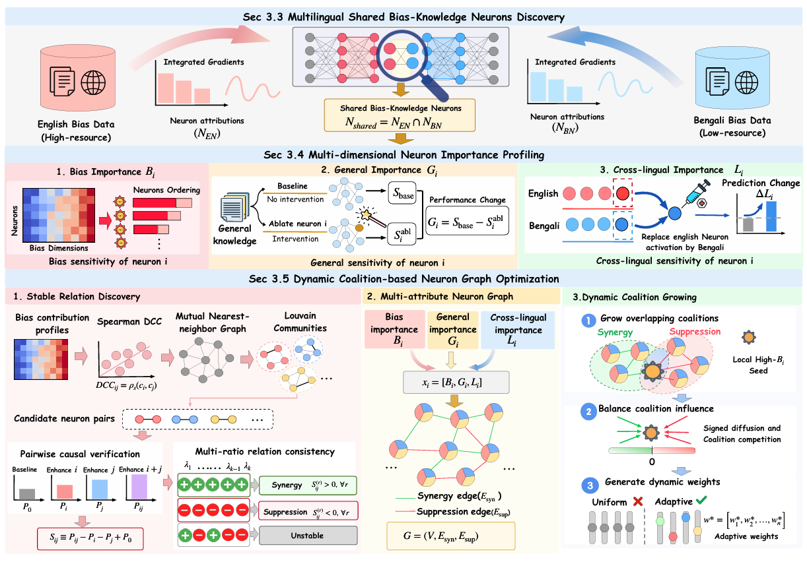

# DANCE: Dynamic and Adaptive Neuron Coalition Enhancement

<p align="center">
  
</p>

**DANCE** (Dynamic and Adaptive Neuron Coalition Enhancement) is a graph-guided framework for joint debiasing across high- and low-resource languages. It identifies shared bias-knowledge neurons and profiles their debiasing contributions, general-knowledge sensitivity, and cross-lingual functionality. A signed graph captures synergistic and suppressive interactions, enabling a coalition optimizer to jointly determine neuron-specific enhancement weights. These weights are fixed for each model and language pair and applied to both languages during inference, with model parameters frozen. DANCE aims to reduce social bias while preserving general capabilities.

## Project layout

```text
DANCE/
├── run.py                  # Unified workflow entry point
├── dance/
│   ├── data_preparation/    # Cross-language data construction
│   ├── discovery/           # Bias-neuron discovery and analysis
│   ├── profiling/           # Bias, general, and cross-language importance
│   ├── graph/               # Contribution profiles, interactions, and coalitions
│   ├── evaluation/          # Bias and multilingual benchmark evaluation
│   ├── core/               # Shared LLM and neuron-intervention utilities
│   ├── cli.py              # Command dispatch
│   └── paths.py            # Shared resource locations
├── assets/                 # Framework figure used in this README
├── prompts/                # Evaluation prompt templates
├── data/                   # Locally acquired input datasets
├── results/                # Generated results and benchmark outputs
├── docs/                   # Workflow and file-migration reference
├── tests/                  # Lightweight entry-point and path checks
├── pyproject.toml          # Editable-install and console-command metadata
└── requirements.txt        # Runtime dependencies
```

See [the workflow guide](docs/workflow.md) for input/output handoffs and
[the migration reference](docs/project_structure.md) for every relocated file.

## Environment

Use Python 3.10 or newer and an isolated environment:

```bash
python -m venv .venv
source .venv/bin/activate
pip install -r requirements.txt
python run.py --help
```

The unified entry point works from a checkout without installing the project.
Optionally install this checkout in editable mode to enable the `dance` command:

```bash
pip install -e . --no-deps
dance --help
```

`python -m dance` is also available from the repository root or after editable
installation. Invoke workflow modules through one of these entry points rather
than executing nested `.py` files directly.

Model checkpoints can be Hugging Face identifiers or local paths supplied at
runtime. Credentials are read from environment variables:

```bash
export HF_TOKEN="<token>"
export DASHSCOPE_API_KEY="<key>"
```

`HF_TOKEN` is optional; `DASHSCOPE_API_KEY` is used by data preparation.
Keep real credentials, private keys, local datasets, and generated logs out of Git.

## Workflow commands

The existing script arguments are forwarded unchanged:

```bash
python run.py <command> [arguments]
python run.py optimize-coalitions --help
```

| Stage | Command | Purpose |
| --- | --- | --- |
| data preparation | `prepare-data` | Prepare cross-language distractor data. |
| discovery | `discover-neurons` | Discover bias-knowledge neurons. |
| discovery | `analyze-neurons` | Summarize discovered neurons. |
| profiling | `bias-importance` | Measure bias importance. |
| profiling | `general-importance` | Measure general-knowledge sensitivity. |
| profiling | `extract-activations` | Extract low-resource neuron activations. |
| profiling | `cross-language-importance` | Measure cross-language activation-replacement effects. |
| graph | `neuron-contributions` | Generate contribution profiles for graph construction. |
| graph | `identify-modules` | Find communities and candidate neuron pairs. |
| graph | `analyze-interactions` | Evaluate pairwise neuron interactions. |
| graph | `interaction-stability` | Compare interactions across enhancement strengths. |
| graph | `optimize-coalitions` | Compute adaptive coalition weights. |
| evaluation | `evaluate-bias` | Run the original bias/capability benchmark entry point. |
| evaluation | `evaluate-multilingual` | Run multilingual benchmark evaluation. |

## 1. Prepare data

Acquire the required datasets separately and place them in `data/`. See
[data/README.md](data/README.md) for expected filenames and schemas.

```bash
python run.py prepare-data \
  --input data/cross_language_source.jsonl \
  --output data/cross_language.jsonl
```

The supplied data-preparation utility uses one configured API model. The
paper's two-generator filtering procedure must be completed before using the
resulting profiling set in experiments.

## 2. Discover shared neurons

```bash
CUDA_VISIBLE_DEVICES=0 python run.py discover-neurons \
  --model_name meta-llama/Llama-3.2-3B-Instruct \
  --condition Gender_identity

CUDA_VISIBLE_DEVICES=0 python run.py analyze-neurons \
  --model_name meta-llama/Llama-3.2-3B-Instruct \
  --condition Gender_identity
```

Repeat attribution for each language and intersect the selected neuron sets.
Set the relevant neuron lists in the profiling/evaluation modules for each
backbone and language pair.

## 3. Profile neuron importance

```bash
CUDA_VISIBLE_DEVICES=0 python run.py bias-importance \
  --model_name meta-llama/Llama-3.2-3B-Instruct

CUDA_VISIBLE_DEVICES=0 python run.py general-importance \
  --model_name meta-llama/Llama-3.2-3B-Instruct

CUDA_VISIBLE_DEVICES=0 python run.py extract-activations \
  --model_name meta-llama/Llama-3.2-3B-Instruct \
  --input_file data/cross_language.jsonl \
  --output_file results/cross_language.activations.jsonl

CUDA_VISIBLE_DEVICES=0 python run.py cross-language-importance \
  --model_name meta-llama/Llama-3.2-3B-Instruct \
  --input_file results/cross_language.activations.jsonl
```

## 4. Build interactions and optimize coalitions

```bash
CUDA_VISIBLE_DEVICES=0 python run.py neuron-contributions \
  --model_name meta-llama/Llama-3.2-3B-Instruct

python run.py identify-modules \
  --input data/neuron_bias_contributions.csv \
  --output_dir results
```

Prepare `data/candidate_neuron_pairs.csv` from the candidate output as described
in [docs/workflow.md](docs/workflow.md), then evaluate each enhancement strength:

```bash
for strength in 1.5 2.0 2.5 3.0 3.5; do
  CUDA_VISIBLE_DEVICES=0 python run.py analyze-interactions \
    --model_name meta-llama/Llama-3.2-3B-Instruct \
    --pairs_file data/candidate_neuron_pairs.csv \
    --enhance_value "$strength"
done

python run.py interaction-stability \
  --model-name Llama-3.2-3B-Instruct \
  --results-dir results

python run.py optimize-coalitions \
  --data-dir data \
  --gamma 1.0 \
  --output results/neuron_coalition_weights.csv
```

The optimizer consumes normalized CSV inputs. It does not automatically convert
all preceding outputs or rerun multi-ratio verification of supplied edges.

## 5. Evaluate benchmarks

```bash
CUDA_VISIBLE_DEVICES=0 python run.py evaluate-bias \
  --model_name meta-llama/Llama-3.2-3B-Instruct \
  --dataset crows \
  --all

CUDA_VISIBLE_DEVICES=0 python run.py evaluate-multilingual \
  --model_name meta-llama/Llama-3.2-3B-Instruct \
  --dataset ban_stereo \
  --all
```

Benchmark tables are saved under `results/benchmarks/`. Optional per-neuron
factors are loaded from `results/enhance_factor_results.json` by the multilingual
entry point; see [results/README.md](results/README.md) for the expected format.

## Paths and validation

Built-in dataset, prompt, cache, and output defaults are resolved from the
checkout location by `dance/paths.py`. Explicit relative CLI paths are relative
to the working directory, except `--pairs_file`, which retains its project-root
resolution. Run the examples above from the repository root.

```bash
python -m unittest discover -s tests -v
```

These checks cover entry-point routing, resource locations, import relocation,
and syntax without downloading models or loading GPU dependencies.
